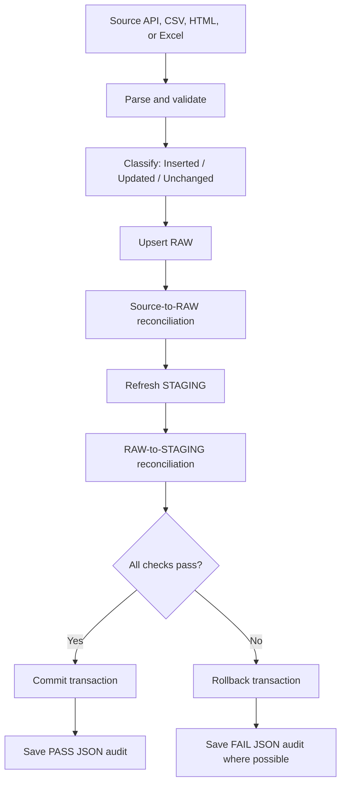

# Data Reconciliation & Audit Trail

**Project:** Rent vs. Buy Financial Analytics Platform  
**Stack:** Python · PostgreSQL · SQL · pandas · JSON  
**Scope:** External data ingestion, analysis refresh, and owner/renter simulations

## Overview

This project uses repeatable refresh pipelines to move financial and housing data from public sources into PostgreSQL and, ultimately, financial simulations. Reconciliation checks help detect missing records, unexpected changes, mismatched values, and incomplete calculation outputs **before a database transaction commits**.

The workflow is:

```text
Data Refresh → Validation → Reconciliation → Change Log / Audit Report
                                    ↓
                         Investigate unexpected changes
                                    ↓
                           Fix cause → Rerun → Verify
```

The TSX pipeline provides a concrete debugging example:

> **Data Refresh → Reconciliation → Change Log → Detect Repeated Updates → Identify Precision Issue → Apply Comparison Rule → Rerun**

## 1. Data ingestion reconciliation



### What is checked?

| Stage | Validation | Purpose |
|---|---|---|
| Source parsing | Expected schema, identifiers, dates, duplicates, numeric values, missing-value rules | Reject malformed input |
| Classification | `Inserted + Updated + Unchanged = Valid records` | Account for every processed record |
| RAW write | Expected inserted/updated count equals actual changed-row count | Catch unintended or missing writes |
| Source → RAW | Compare source keys and values with stored RAW records | Verify ingestion fidelity |
| RAW → STAGING | Compare transformed records, including relevant NULLs and pivot logic | Verify staging fidelity |
| Commit / audit | Commit only after checks; write a run-specific JSON report | Make results traceable |

**Important:** Not every pipeline has the same schema. Rent and CREA data are stored by city and date in RAW, but pivoted into date-based rows in STAGING. Comparing their *total row counts* would be misleading; their reconciliation compares the expected transformed values instead.

The shared `update_python/reconciliation.py` provides report creation, classification counts, change-count checks, and JSON export. Each update script owns its **source-specific SQL comparisons, transactions, and special rules**.

## 2. TSX case study: discovering repeated updates

### Step 1 — Refresh and reconcile

`update_tsx.py` retrieves monthly TSX (`^GSPTSE`) data from Yahoo Finance, checks the source against `raw.tsx_raw`, and checks adjusted close prices against `stg.tsx_cad`.

### Step 2 — Capture a detailed RAW change log

The JSON audit records the changed month, action (`INSERT` / `UPDATE`), changed column, and previous/new values. This made otherwise invisible historical corrections inspectable.

### Step 3 — Detect unexpected repetition

Repeated runs initially reported **10 updated historical months**, even though the same periods had already been synchronized. The detailed log showed tiny changes in `adj_close_price`; for example:

```text
Month: 1990-02
Old adjusted close: 3677.33740234375
New adjusted close: 3677.337890625
Difference: 0.00048828125
```

These were small enough to be consistent with floating-point representation or upstream rounding differences. The log exposed the symptom; it did not conclusively establish which system introduced the variation.

### Step 4 — Define a documented comparison rule

The TSX script was adjusted so that `adj_close_price` is treated as changed only if its absolute difference exceeds **0.001**, or if its NULL status changes. Other fields continue using their existing exact comparisons.

The same rule is applied consistently to:

- Python's Inserted / Updated / Unchanged classification
- PostgreSQL's conditional `ON CONFLICT DO UPDATE`
- API → RAW reconciliation
- The detailed RAW change log

The JSON report also records the configured tolerance under `comparison_rules`.

**Trade-off:** A tolerance can intentionally ignore genuine revisions smaller than 0.001. It is a documented project rule, not proof that source precision is always irrelevant.

### Step 5 — Rerun and verify

Two consecutive local runs reported:

```text
API/RAW reconciliation: PASS (441 months verified)
RAW/STAGING reconciliation: PASS
Inserted records: 0
Updated records: 0
Unchanged records: 441
Detailed RAW changes recorded: 0
```

**Result:** Repeated TSX updates stopped under the chosen comparison rule, and the pipeline produced consistent reconciliation reports.

## 3. Additional pipeline-specific rules

| Pipeline | Source | Notable reconciliation rule |
|---|---|---|
| FRED USD/CAD | FRED | Recheck recent dates to detect revisions; reconcile RAW and STAGING |
| CPI | Statistics Canada | Recheck the recent monthly history |
| S&P 500 | Yahoo Finance | Retain completed months only; reconcile adjusted close |
| TSX | Yahoo Finance | Detailed RAW change log; adjusted-close tolerance |
| Mortgage | Statistics Canada | Recheck 12 months of rates |
| Rent | CMHC | Compare city-year data and seven-city STAGING pivot; preserve suppressed values |
| City house prices | CREA MLS HPI | Reconcile all 12 source metrics and both price/HPI STAGING tables |
| Canada real house index | BIS | Reconcile quarterly index and observation metadata |
| City house index | Teranet C11 | Reconcile 60 source metrics and the six-city index STAGING output |

## 4. Analysis and simulation reconciliation

### Analysis refresh

`update_analysis.py` executes three SQL refresh files in one PostgreSQL transaction:

1. `04_analysis_refresh_real_asset_indexes.sql`
2. `04_analysis_refresh_long_tables.sql`
3. `04_analysis_refresh_asset_cagr.sql`

Its checks include STAGING coverage and date uniqueness, analysis key integrity, long-table reconciliation, index rebasing checks, and before/after table summaries across **13 analysis tables**. A successful local run generated a JSON report.

**Limit:** These checks do not independently recalculate every CAGR, currency conversion, and inflation-adjustment formula. Equal before/after row counts do not mean every value is unchanged.

### Owner simulation

`update_owner.py` recalculates scenario histories in batches of 100. It checks saved monthly inputs and Python-generated outputs against PostgreSQL records while preserving the existing transaction and scenario IDs.

Observed local test:

```text
Owner scenarios recalculated: 27,972
Owner monthly observations processed: 3,089,772
Owner monthly input/result reconciliation: PASS (3,089,772 rows verified)
Owner monthly inputs inserted or updated: 0
Owner monthly results inserted or updated: 0
```

**Limit:** This verifies persistence and completeness, not an independent financial proof of the mortgage or net-worth formulas.

### Renter simulation

`update_renter.py` takes owner cash-flow paths and evaluates two investment portfolios (`sp500_only`, `tsx_only`). Its reconciled version adds batch-level checks for the saved renter inputs and results and creates a JSON audit report. **The updated renter script has not yet been confirmed by a local execution result in this documentation.**

## 5. Audit reports

Run-specific JSON files are written under:

```text
SQL-Python/
├── update_python/
│   ├── reconciliation.py
│   ├── update_tsx.py
│   ├── update_owner.py
│   └── update_renter.py
└── reconciliation_reports/
    ├── tsx_<run_id>.json
    ├── owner_<run_id>.json
    └── renter_<run_id>.json
```

Depending on the pipeline, a report captures the run identifier, source, timestamps, record counts, check statuses, commit status, and error type. TSX also includes detailed field-level changes and comparison settings. The exact JSON schema varies between ingestion and simulation scripts.

The reports are **audit evidence for pipeline runs**, not a replacement for database backups, automated test suites, or independent validation of financial assumptions. Generated JSON reports should usually be excluded from Git tracking; share carefully reviewed, sanitized examples if needed. Never commit `API.env` or credentials.

## 6. How to run

From the `SQL-Python/update_python/` directory:

```powershell
# Optional: test shared helpers without a database connection
python3 .\reconciliation.py

# Example external refresh
python3 .\update_tsx.py

# Analysis must refresh before simulations
python3 .\update_analysis.py
python3 .\update_owner.py
python3 .\update_renter.py
```

After a run, review its `PASS` / `FAIL` output and inspect the matching JSON file in `reconciliation_reports/`. Re-running without source or assumption changes should ideally produce zero changed records; new source data or real revisions should produce meaningful changes.

## 7. Validation status and remaining work

**Verified in local run logs:** nine external ingestion pipelines, the analysis refresh, and the owner simulation all passed their implemented reconciliation checks. **Pending:** local execution confirmation for the modified renter pipeline.

Further testing should cover new INSERTs, genuine source revisions, malformed inputs, rollback under injected failures, and independent checks of financial formulas. An isolated FRED rollback test has been run, but it does not amount to end-to-end rollback testing of every pipeline.

---

**Key takeaway:** Reconciliation is more than checking record counts. It provides a way to trace changes, isolate anomalies, apply explicit comparison rules, verify database writes, and preserve auditable evidence of each refresh.
