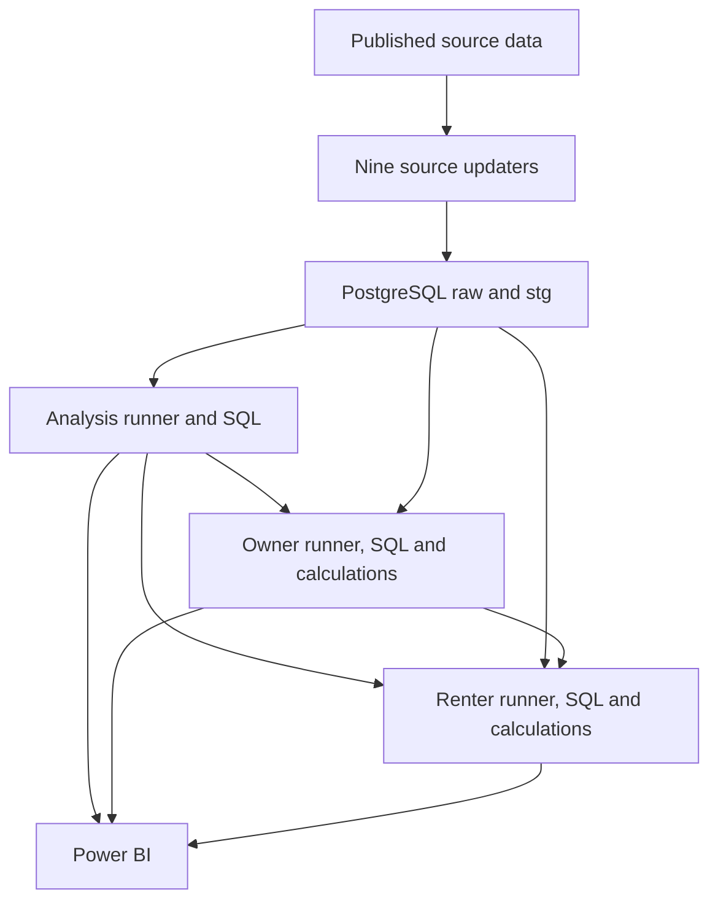

# Data update guide

This project refreshes an existing local PostgreSQL database through Python entry points. Source updaters fetch published observations and synchronize `raw` and `stg`; downstream runners rebuild analysis data and recalculate owner and renter paths. Power BI reads the resulting tables.

This guide describes the delivered scripts and the reorganized folder layout. Put it at `SQL-Python/DATA_UPDATE_GUIDE.md` so the relative code links below work on GitHub. The dates and counts in the completed-run example are a recorded snapshot, not a claim that every source publishes through the same month.

## 1. What each folder does

| Location under `SQL-Python` | Role | How it is used |
| --- | --- | --- |
| `update_python/` | User-facing Python entry points | Run these scripts to fetch sources or refresh a downstream layer. |
| `update_python/API.env` | Local database password and FRED key | Read by the scripts from their own directory. Keep this file out of Git. |
| `create_SQL/` | Database setup and downstream refresh SQL | `01`–`03` are setup/load scripts. The analysis and simulation entry points execute the corresponding `04`–`06` refresh files. |
| `simulation_python/` | Owner and renter mathematical functions | Imported by the simulation entry points. These modules do not fetch new source data. |
| `check_SQL/` | Separate database inspection queries | Run manually when investigating a problem. The runners also perform their own built-in checks; they do not automatically execute these four inspection files. |

The `01`–`03` setup scripts are not part of the routine refresh sequence. The source updaters expect the existing raw and staging tables; some also require an initial historical load. A fresh database needs a separate setup/import procedure before routine updates will work.

The three reorganized downstream runners resolve resources from their own file location:

```python
HERE = Path(__file__).resolve().parent        # update_python
PROJECT_DIR = HERE.parent                    # SQL-Python
SQL_DIR = PROJECT_DIR / "create_SQL"
CALC_DIR = PROJECT_DIR / "simulation_python" # simulation runners
```

They read `API.env` from `HERE`. The simulation runners add `CALC_DIR` to the Python import path. Changing the terminal's working directory does not change these resource locations.

## 2. How the layers connect



| Layer | Stores | What causes it to update |
| --- | --- | --- |
| `raw` | Source-aligned history, often retaining text labels, source fields and quality flags | A source updater fetches and writes observations. These tables are not immutable copies of entire HTTP responses. |
| `stg` | Typed dates/numbers, selected measures and city pivots | The same source updater explicitly runs staging SQL after updating raw. |
| `analysis` | Real/rebased indexes, city long tables, CAGR tables and summaries | `update_analysis.py` explicitly reruns the three analysis SQL files. |
| `simulation` | Scenario assumptions and monthly owner/renter inputs and results | `update_owner.py`, then `update_renter.py`, prepare inputs and run recursive calculations. |

An ordinary table populated with `INSERT ... SELECT` does not automatically synchronize when its source changes. The new entry points perform that synchronization explicitly.

Uploading code to GitHub does not run these scripts or update your local PostgreSQL database. No scheduler is configured by these files. Refreshing Power BI reads database results; it does not run the Python pipeline.

## 3. Where updated observations come from

The current routine has nine source updaters, accessing seven provider services/sites. Each source updater writes its own raw and staging tables in one transaction.

| Entry point in `update_python` | Data and frequency loaded | Retrieval method | Credential used by the script |
| --- | --- | --- | --- |
| [update_fred.py](update_python/update_fred.py) | CAD per USD, `DEXCAUS`; daily observations | FRED observations API, HTTP GET returning JSON | `FRED_API_KEY` and database password |
| [update_cpi.py](update_python/update_cpi.py) | Canada all-items CPI, 2002=100, not seasonally adjusted; monthly | Statistics Canada WDS, HTTP POST returning JSON | Database password; no source key supplied |
| [update_mortgage.py](update_python/update_mortgage.py) | Canada conventional mortgage lending rate, five-year term; monthly percent | Statistics Canada WDS, HTTP POST returning JSON | Database password; no source key supplied |
| [update_bis_house_index.py](update_python/update_bis_house_index.py) | Canada **real** residential property price index, 2010=100; quarterly | BIS SDMX API, HTTP GET requesting CSV | Database password; no source key supplied |
| [update_city_house_index.py](update_python/update_city_house_index.py) | Teranet C11/city house-price history; monthly | Direct HTTP GET of a CSV, or a local CSV fallback | Database password; no source key supplied |
| [update_city_house_prices.py](update_python/update_city_house_prices.py) | CREA MLS HPI and benchmark prices; seasonally adjusted monthly workbook | Discover the package link on CREA's page, download ZIP, read XLSX; local-file fallback available | Database password; no source key supplied |
| [update_tsx.py](update_python/update_tsx.py) | TSX Composite `^GSPTSE`, CAD; monthly bars | `yfinance.Ticker.history()` | Database password; no user-supplied Yahoo key |
| [update_sp500.py](update_python/update_sp500.py) | S&P 500 `^GSPC`, USD; monthly bars | `yfinance.Ticker.history()` | Database password; no user-supplied Yahoo key |
| [update_rent.py](update_python/update_rent.py) | CMHC Row / Apartment average rent, October survey; annual observations | HTTP GET of public historical table pages, parse HTML and embedded metadata | Database password; no source key supplied |

These are different retrieval mechanisms. A CSV or ZIP download can be automated without being an API call. The stock scripts use the open-source `yfinance` client for Yahoo's public interfaces; this is not an official authenticated Yahoo developer API integration. See the [yfinance project](https://github.com/ranaroussi/yfinance).

### FRED: exchange rates

Configured endpoint: `https://api.stlouisfed.org/fred/series/observations`.

The script sends `series_id=DEXCAUS`, the API key, JSON format, a start date and ascending sort order. `DEXCAUS` is **Canadian dollars per one US dollar**: multiply a USD amount by this rate to obtain CAD. Published missing markers such as `.` are skipped rather than treated as zero.

The script reads the latest raw date and fetches from 30 days before it to capture recent revisions. See the [series definition](https://fred.stlouisfed.org/series/DEXCAUS) and [FRED API key documentation](https://fred.stlouisfed.org/docs/api/api_key.html).

### Statistics Canada: CPI and mortgage rates

Both scripts POST JSON to the WDS methods documented in the [official user guide](https://www.statcan.gc.ca/en/developers/wds/user-guide). A browser normally makes a GET request when you paste an address, so opening a POST endpoint as a webpage is not the same operation as running the script.

| Setting | CPI | Mortgage |
| --- | --- | --- |
| Published table | [18-10-0004-01](https://www150.statcan.gc.ca/t1/tbl1/en/tv.action?pid=1810000401) | [34-10-0145-01](https://www150.statcan.gc.ca/t1/tbl1/en/tv.action?pid=3410014501) |
| API product/cube ID | `18100004` | `34100145` |
| Series selector | Vector `41690973` | Coordinate `1.0.0.0.0.0.0.0.0.0` |
| Method under `https://www150.statcan.gc.ca/t1/wds/rest/` | `getDataFromVectorsAndLatestNPeriods` | `getDataFromCubePidCoordAndLatestNPeriods` |
| JSON body fields | `vectorId`, `latestN` | `productId`, `coordinate`, `latestN` |

The eight-digit API cube IDs differ from the ten-digit table-viewer PIDs ending in `01`. A vector or cube-plus-coordinate selects a particular series, rather than every series in the table.

The scripts calculate `latestN` dynamically, filter the response to the requested start date, and validate series identity, period dates, scale and values. Each rechecks from twelve months before the latest stored month. The mortgage updater expects an existing historical load; the CPI updater has an empty-table fallback starting in January 1914.

### BIS: national real house-price index

Configured endpoint:

```text
https://stats.bis.org/api/v2/data/dataflow/BIS/WS_SPP/1.0/Q.CA.R.628
```

The request asks for SDMX CSV using an `Accept` header. The script validates the dataflow, quarterly frequency, Canada area, real-value selector and 2010=100 unit. It converts quarter labels into calendar quarter-end dates and rechecks the entire stored history range. It requires the existing raw series metadata and a valid earliest quarter-end date. See [BIS API documentation](https://stats.bis.org/api-doc/v2/).

### Teranet: city house-price indexes

Configured CSV:

[https://housepriceindex.ca/_data/House_Price_Index.csv](https://housepriceindex.ca/_data/House_Price_Index.csv)

The script downloads the CSV, validates and flattens its two-row header, preserves all 61 raw columns, and selects the original six city index columns for staging. It rereads the available history while retaining the database's existing start month. Missing numeric cells remain missing; they are not zero-filled.

If the direct download fails, obtain the history CSV from the [publisher's download page](https://housepriceindex.ca/download-data/) and use the `--csv` option shown below.

### CREA: benchmark house prices and MLS HPI

The script attempts to find one current `MLS_HPI_*.zip` link on the [official HPI tool page](https://www.crea.ca/housing-market-stats/mls-home-price-index/hpi-tool/), then opens **`Seasonally Adjusted (M).xlsx`** inside it. It also accepts that workbook directly as a local file.

`M` selects the monthly workbook. Use this exact seasonally adjusted file, rather than the annual workbook, a not-seasonally-adjusted workbook, or `News_release_chart_data_*.xlsx`.

It reads Canada plus six regional market sheets. The source's regional names are mapped to the existing database city labels:

| Database label | CREA worksheet |
| --- | --- |
| Canada | `AGGREGATE` |
| Vancouver | `GREATER_VANCOUVER` |
| Calgary | `CALGARY` |
| Edmonton | `EDMONTON` |
| Toronto | `GREATER_TORONTO` |
| Ottawa | `OTTAWA` |
| Montreal | `MONTREAL_CMA` |

Raw retains twelve HPI/benchmark measures per city-month. Staging pivots `composite_benchmark_sa` into city prices and `composite_hpi_sa` into city indexes. Existing undated placeholder rows are left in raw but excluded from these dated pivots.

The name `raw.city_house_real_prices` is an existing table name; its benchmark price field is not, by that name alone, an inflation-adjusted price. Inflation adjustments are calculated explicitly elsewhere in the model.

Package discovery depends on the publisher's HTML and allowed link host. If the page or download hosting changes, the script reports a discovery error; use `--source` with the correct official package while repairing discovery. A release package's filename month can differ from the latest observation month: use the parsed source date range to judge coverage.

### Yahoo Finance: stock indexes

The scripts request `interval="1mo"` with `auto_adjust=False` and retain the returned adjusted-close field. They verify the reported currency and recheck history from the earliest stored date.

Only **completed calendar months** are loaded: the first day of the current month is the exclusive end date. A date such as `2026-09-01` labels the September monthly bar; it is not the publication date or a claim that the closing price was observed on September 1.

The S&P 500 staging series remains in USD; the analysis layer converts it to CAD using the existing exchange-rate alignment. The TSX series is already in CAD. The current implementation uses the selected index price series; this update process does not change their return methodology or turn them into a different total-return benchmark.

### CMHC: annual rent observations

The script requests table `2.2.11` for Canada and six cities, checks the source geography, measure and filters, then reads the historical HTML table. Its required source filters are **Row / Apartment** and **October**. Raw keeps bedroom-specific rents and quality flags; staging uses the **Total** rent measure.

[Toronto source table](https://www03.cmhc-schl.gc.ca/hmip-pimh/en/TableMapChart/Table?TableId=2.2.11&GeographyId=2270&GeographyTypeId=3&DisplayAs=Table).

The configured CMHC portal IDs are Canada `1` (type 1), Vancouver `2410`, Calgary `0140`, Edmonton `0340`, Toronto `2270`, Ottawa `1265` and Montreal `1060` (the six cities use type 3). These are portal IDs, not Statistics Canada CMA codes.

All seven locations are fetched before database access. Existing city-specific start years are retained. Suppression markers remain in raw and become SQL `NULL` in staging. An annual survey observation is not twelve independently observed monthly rents.

## 4. Which tables each source updater writes

| Updater | Raw table | Staging table(s) |
| --- | --- | --- |
| FRED | `raw.usd_cad_raw` | `stg.usd_cad` |
| CPI | `raw.canada_cpi_raw` | `stg.canada_cpi` |
| Mortgage | `raw.canada_5yearmortgage_raw` | `stg.canada_5yearmortgage` |
| BIS | `raw.canada_house_price_index_2010_100` | `stg.canada_house_price_index_2010_100` |
| Teranet | `raw.city_house_price_index` | `stg.city_house_price_index` |
| CREA | `raw.city_house_real_prices` | `stg.city_house_prices`, `stg.city_indexed_house_prices` |
| TSX | `raw.tsx_raw` | `stg.tsx_cad` |
| S&P 500 | `raw.sp500_raw` | `stg.sp500_usd` |
| CMHC rent | `raw.city_rent_raw` | `stg.city_rent` |

The national BIS real index, Teranet city indexes, and CREA benchmark prices/HPI are different datasets. The current owner simulation gets purchase, sale and monthly market prices from the **CREA benchmark-price path**, through `analysis.city_house_prices_long`.

### How much history is rechecked?

| Source | Fetch/recheck policy |
| --- | --- |
| FRED | Latest stored date minus 30 days onward |
| CPI and mortgage | Twelve months before the latest stored month onward |
| BIS | Full source series, retaining the existing earliest stored quarter |
| Teranet | Full history file, retaining the existing database start month |
| CREA | Full selected monthly workbook for the seven markets, with coverage checks against existing history |
| TSX and S&P 500 | Full range from each series' earliest stored monthly date |
| CMHC | Full published annual history, keeping each city's existing start period |

Fetching a full file does not mean inserting every row again. The source updaters use unique keys and conditional upserts to insert new records and replace changed values. Their staging SQL also resynchronizes existing raw history. Therefore, raw can report zero changes while staging repairs previously outdated rows.

The shorter FRED/CPI/mortgage windows do not guarantee capture of revisions older than their lookback periods. An older revision requires a deliberate historical backfill. The current raw tables store revised values in place; they do not preserve every historical publication vintage.

## 5. Downstream runners and their files

| Entry point | SQL files in `create_SQL`, in execution order | Calculation module |
| --- | --- | --- |
| [update_analysis.py](update_python/update_analysis.py) | `04_analysis_refresh_real_asset_indexes.sql` → `04_analysis_refresh_long_tables.sql` → `04_analysis_refresh_asset_cagr.sql` | SQL calculations executed through Python |
| [update_owner.py](update_python/update_owner.py) | `05_refresh_owner_scenarios.sql` → `05_refresh_owner_months.sql` | [owner_calculations.py](simulation_python/owner_calculations.py) |
| [update_renter.py](update_python/update_renter.py) | `06_prepare_renter_refresh.sql` → `06_refresh_renter_months.sql` | [renter_calculations.py](simulation_python/renter_calculations.py) |

### Analysis refresh

The analysis runner checks its staging dependencies, executes the three SQL files, checks the results, then commits once. It clears and repopulates the target rows while retaining existing table objects. This is a full data recalculation, not a `DROP TABLE` rebuild.

It refreshes thirteen tables: five index-related outputs, two long tables, five CAGR tables and one summary:

```text
analysis.canada_house_price_index_1990_100
analysis.sp500_index_1990_100
analysis.tsx_index_1990_100
analysis.vt_cad_real
analysis.city_indexed_house_prices
analysis.city_house_prices_long
analysis.city_rent_long
analysis.canada_house_cagr
analysis.sp500_cagr
analysis.tsx_cagr
analysis.vt_cagr
analysis.city_house_cagr
analysis.sum_canada_stock_cagr
```

The long tables reshape current staging values into `(date_period, city, price)`, preserving numeric `NULL`s and excluding undated rows.

Legacy date and financial alignments are retained: BIS analysis labels are staging quarter-end dates plus one day; S&P 500 CAD conversion uses the last available FX date on or before the monthly label. These labels should not be mistaken for release timestamps. The refresh mechanism did not redesign those model choices.

**VT limitation:** this routine has no `update_vt.py`. Analysis still requires and reads existing `stg.vt_usd`; recalculating `analysis.vt_cad_real` does not download newer VT prices. In the recorded analysis run, VT ended at May 2026. If VT is used in reporting, add/update its source ingestion separately. The current renter portfolios are TSX and S&P 500.

### Owner refresh

The owner runner reads city benchmark prices from analysis and five-year mortgage rates from staging. It seeds missing city assumptions, retains existing scenario IDs, updates source-derived inputs and recalculates each path from month zero in batches of 100 complete scenarios.

Its cutoff is the earliest of the seven cities' latest valid price months and the latest valid mortgage month. Required gaps within that coverage are errors rather than interpolated values. Scenario creation still requires actual purchase and sale prices at the requested holding-period endpoints; it does not forecast future sale prices.

The original mortgage payment, renewal, ownership-cost and net-worth formulas remain in the calculation module. Existing relevant saved assumptions are retained; new scenarios use the original defaults. All batches commit together or roll back together.

### Renter refresh

The renter runner rereads the current owner results, annual city rents, S&P 500/TSX CAD prices and CPI. It calculates two portfolios at the original default investment discipline of `1.00`, keeping each owner path's months and portfolios together in a batch.

Its cutoff is the minimum of owner coverage, both stock-price coverages, CPI coverage and the latest rent year's December under the existing calendar-year rent rule. For example, an October 2025 rent observation is applied to January–December 2025 in this model. It is not extended to 2026.

The original rent recursion, seed-42 moving sequence, investment cash flows, zero portfolio floor and CPI-based net-worth formulas remain. Missing investment-month stock returns are rejected instead of silently filled with zero; month zero still receives no return. The runner preserves existing renter row IDs and commits all batches together.

Owner and renter entry points share a simulation-run lock. Existing rows outside a runner's active scope are retained and reported rather than silently deleted; those rows have not been recalculated by that run.

## 6. Run a future update

### Local prerequisites

Use the same Python interpreter that runs the project. Install missing dependencies if needed:

```powershell
python3 -m pip install "psycopg[binary]" python-dotenv pandas numpy yfinance openpyxl beautifulsoup4 truststore
```

The current scripts connect to `localhost:5432`, database `rentvsbuy`, user `postgres`. Keep the real configuration at `SQL-Python/update_python/API.env`:

```dotenv
pg_password=YOUR_LOCAL_DATABASE_PASSWORD
FRED_API_KEY=YOUR_OWN_FRED_API_KEY
```

These are placeholders, not usable credentials. FRED requires an API key; obtain your own through its account/API-key page. Keep `API.env` ignored by Git. A publicly committed example file can contain placeholders, but no real values.

### Run the ordered sequence

Start in the repository root, then enter the project folder:

```powershell
Set-Location .\SQL-Python
```

If already in `SQL-Python`, do not repeat that directory change. Paste this block once:

```powershell
Get-Command python3 -ErrorAction Stop | Out-Null

$updates = @(
    "update_fred.py"
    "update_cpi.py"
    "update_mortgage.py"
    "update_bis_house_index.py"
    "update_city_house_index.py"
    "update_city_house_prices.py"
    "update_tsx.py"
    "update_sp500.py"
    "update_rent.py"
    "update_analysis.py"
    "update_owner.py"
    "update_renter.py"
)

foreach ($script in $updates) {
    $entry = Join-Path ".\update_python" $script
    if (-not (Test-Path -LiteralPath $entry)) {
        throw "Missing update script: $entry"
    }

    Write-Host "Running $script..."
    & python3 $entry

    if ($LASTEXITCODE -ne 0) {
        throw "Update stopped: $script failed. Fix it before running downstream steps."
    }
}
```

The first nine scripts update source/raw/staging data. Then analysis runs, owner runs, and renter runs. After successful completion, refresh Power BI and use the comparison cutoff printed by renter.

The loop is a sequence of separate transactions, not one global database transaction. If a later script fails, earlier successful scripts remain committed. Fix the failed step, rerun it and then continue downstream. A failed owner or renter transaction does not leave half of its own batches committed.

Source updaters can run independently when troubleshooting. Analysis and simulations need the appropriate upstream refreshes first. Full simulation recalculation can take several minutes or longer; zero source changes do not cause the current runners to skip their calculations automatically.

### Local-file fallbacks

If Teranet's online download fails, use the official CSV:

```powershell
python3 .\update_python\update_city_house_index.py --csv "$env:USERPROFILE\Downloads\House_Price_Index.csv"
```

If CREA package discovery fails, use the official ZIP containing the required monthly workbook:

```powershell
python3 .\update_python\update_city_house_prices.py --source "$env:USERPROFILE\Downloads\MLS_HPI_RELEASE.zip"
```

Replace `MLS_HPI_RELEASE.zip` with the actual downloaded filename. A direct local `Seasonally Adjusted (M).xlsx` is also accepted. The files in Downloads are inputs; the script files themselves stay in `update_python`.

These two updaters offer `--check-only` for diagnosing source parsing without database access. This is optional troubleshooting, not a required extra run in every update cycle.

## 7. Read the output correctly

| Output | Meaning |
| --- | --- |
| Observations processed | Valid observations or calculated monthly rows examined in that run; not necessarily new rows. |
| Rows inserted or updated | Rows whose stored input/value changed, including historical revisions. |
| Raw total vs raw dated rows | Undated placeholders can make these counts differ in sources that preserve them. |
| Missing values / suppression markers | Source-specific missingness; never assume every such count represents an error or a zero value. |
| Latest source/database date | Latest observation period loaded, not necessarily the publication date. |
| Exit code `0` | The script reported success. `--check-only` can also succeed without writing the database. |
| Nonzero exit code | The script failed; stop downstream processing and inspect the message. |
| Simulation comparison cutoff | Latest month supported by that simulation's required inputs. |

It is normal for a source updater to report zero changes when the publisher has not released or revised anything in the checked range. It is also normal for simulation results to change in many later months after a smaller number of historical input revisions, because recursive balances and cumulative costs propagate forward.

Different missing-data rules apply by source: FRED, CPI, mortgage and BIS skip missing observations; Teranet/CREA can retain numeric missingness, and CMHC preserves suppression markers in raw. A refresh does not universally delete old observations that are absent from a response.

Each routine cycle needs one execution, not repeated reruns to prove completion. A second run should not create duplicate keys, but simulations still do the calculation work. Conditional writes avoid rewriting identical monthly inputs/results; this is different from calculating only newly added months.

## 8. Recorded completed run

These values came from the project's completed run on October 23, 2026. They are useful reference points, not fixed expected outputs for future updates.

| Item | Recorded result |
| --- | --- |
| FRED latest observation | `2026-10-16` |
| CPI and mortgage latest month | `2026-09-01` |
| BIS latest raw/staging quarter end | `2026-06-30` |
| Teranet, CREA, TSX and S&P 500 latest month | `2026-09-01` |
| CMHC latest rent survey | `2025-10-01` |
| Owner scenarios / monthly rows | `27,972` / `3,089,772` |
| Owner latest month | `2026-09-01` |
| Renter paths / monthly rows | `55,944` / `6,156,864` |
| Renter comparison cutoff | `2025-12-01` |

For matching owner/renter comparisons in this recorded run, use the same scenario and month through December 2025. For a completed 5/10/15/20-year holding-period comparison, also select the sale-month rows (`is_sale_month = TRUE`). A path cut off before its planned sale is a partial holding-period path.

The thirteen analysis tables were refreshed from their available staging inputs, but the recorded VT analysis history still ended at May 2026 because its source updater is not part of this routine.

## 9. Troubleshooting and maintenance

| Message or symptom | What to check |
| --- | --- |
| Missing `pg_password` or `FRED_API_KEY` | `API.env` is beside the entry scripts in `update_python` and contains the expected names. Do not print the real values in logs. |
| SQL file not found | Exact `04_analysis_`, `05_`, `06_` filenames under `create_SQL`; use the path-adapted entry scripts. |
| Calculation module not found | Both calculation modules are under `simulation_python`; use the path-adapted owner/renter runners. |
| `ModuleNotFoundError` for a dependency | Install it with the same `python3 -m pip` interpreter used for the script. |
| Certificate verification error | The Teranet/CREA/CMHC scripts use `truststore` for native trust handling. Check that dependency and the machine's certificate/network configuration; retain certificate verification. |
| Download returned HTML instead of CSV | A landing/error page is not the data file. Use the configured CSV or official local-file fallback. |
| CREA package cannot be found | Publisher page/link structure may have changed. Use the correct official ZIP/XLSX through `--source`, then repair discovery. |
| CMHC layout/filter validation fails | Inspect the source table's geography, Row / Apartment filter and October survey setting before changing the parser. |
| Duplicate period/key error | Inspect the relevant records; the updater rejects duplicates rather than choosing an arbitrary record to delete. |
| Missing rent, CPI or stock month in renter | Check the required source and upstream refresh. Do not extend coverage by silently filling missing investment-month returns with zero. |
| Latest dates differ across tables | Compare observation frequencies and release coverage; annual rent and quarterly BIS data need not share monthly stock dates. |
| Power BI still shows old results | Refresh its imported data after the relevant database updates complete. GitHub push/merge does not refresh the report. |

The check files listed in the project layout are `check_SQL/1. raw_schema_checks.sql`, `2. staging_schema_checks.sql`, `3. analysis_schema_checks.sql` and `4. simulation_checks.sql`. Use them for targeted investigation; their contents should be reviewed before execution.

Adding a new dataset or changing columns requires updating its source parser, raw/staging mappings, downstream consumers and documentation. A historical backfill, new source frequency or new simulation assumption should be an explicit change, rather than a side effect of moving files.

## 10. Source documentation

Implementation-specific details above come from the delivered Python/SQL files and the supplied run logs. Public documentation identifies the external services:

- [FRED observations endpoint](https://fred.stlouisfed.org/docs/api/fred/series_observations.html) and [API keys](https://fred.stlouisfed.org/docs/api/api_key.html).
- [Statistics Canada WDS user guide](https://www.statcan.gc.ca/en/developers/wds/user-guide), [CPI table](https://www150.statcan.gc.ca/t1/tbl1/en/tv.action?pid=1810000401), and [five-year mortgage table](https://www150.statcan.gc.ca/t1/tbl1/en/tv.action?pid=3410014501).
- [BIS API documentation](https://stats.bis.org/api-doc/v2/).
- [Teranet download page](https://housepriceindex.ca/download-data/) and [configured history CSV](https://housepriceindex.ca/_data/House_Price_Index.csv).
- [CREA MLS HPI tool/download page](https://www.crea.ca/housing-market-stats/mls-home-price-index/hpi-tool/).
- [yfinance project documentation](https://github.com/ranaroussi/yfinance).
- [CMHC configured Toronto table](https://www03.cmhc-schl.gc.ca/hmip-pimh/en/TableMapChart/Table?TableId=2.2.11&GeographyId=2270&GeographyTypeId=3&DisplayAs=Table).

Publisher links and page formats can change. Retrieval descriptions document the configured code; actual availability and observation coverage are determined by each run's validated response and printed output.
